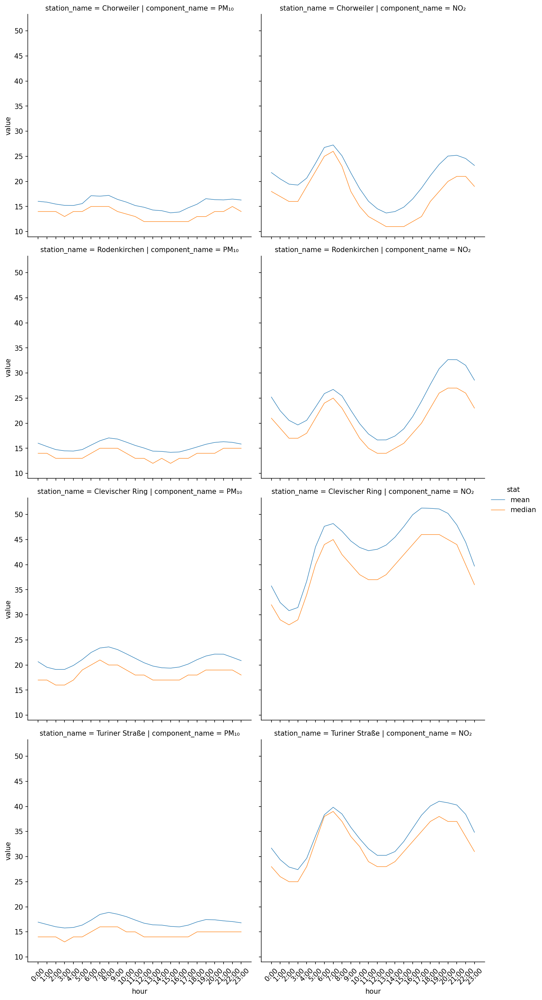
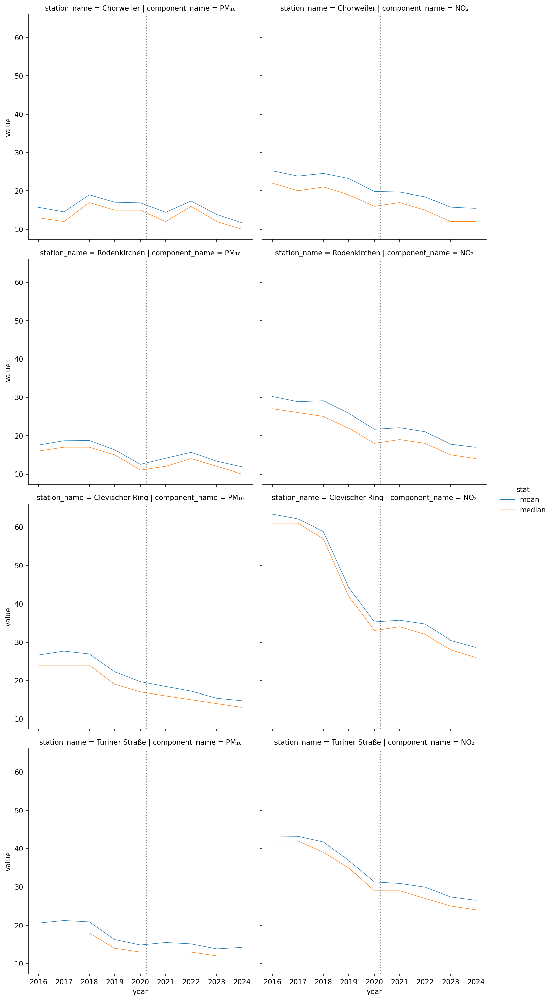
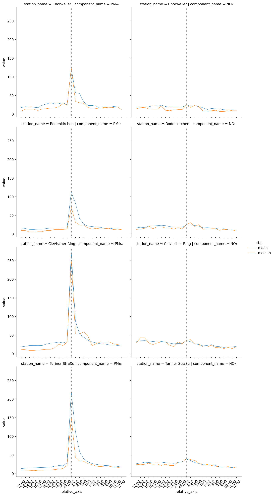
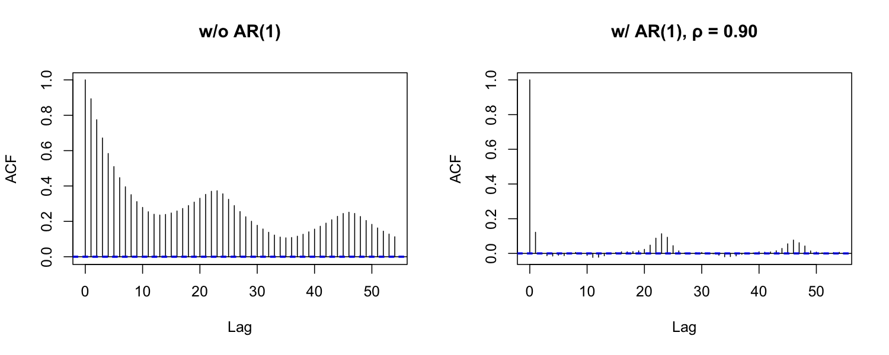
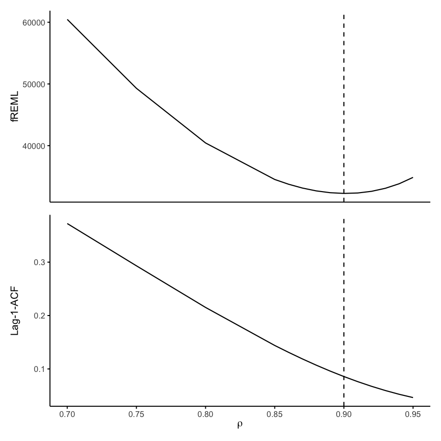
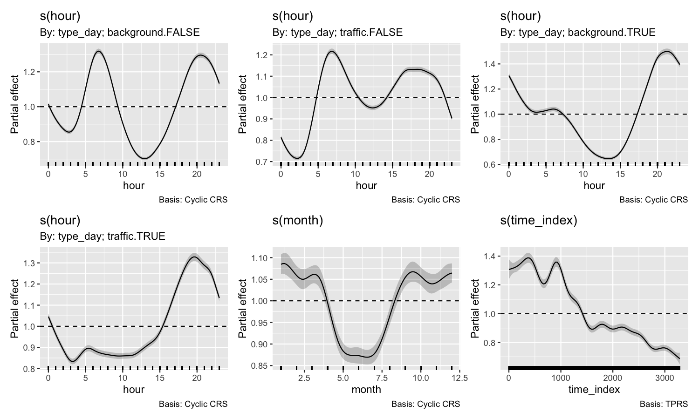

# Air Quality in Cologne: Modelling NO₂ with GAMs


This project analyses hourly NO₂ concentrations at four air quality monitoring stations in Cologne (2016–2024) using **Generalized Additive Models (GAMs)**. It compares traffic and background stations and separates daily, weekly and seasonal patterns from the long-term trend. The data come from the public air quality API of the German Environment Agency (*Umweltbundesamt*, UBA).

## Key Findings

| Group | Factor exp(β) | 95 % CI | Change vs. reference |
|---|---:|---:|---:|
| Background, weekday (reference) | 22.5 µg/m³ | 22.3 – 22.7 | – |
| Traffic, weekday | 1.79 | 1.77 – 1.82 | **+79 %** |
| Background, weekend | 0.79 | 0.78 – 0.80 | **−21 %** |
| Traffic, weekend | 1.44 | 1.42 – 1.46 | **+44 %** |

*Estimates from the final Tweedie GAM with AR(1) errors (ρ = 0.90), adjusted for time of day, season and long-term trend. The reference level is a model-based mean at average values of the smooth terms.*

- **Traffic vs. background:** Mean NO₂ at traffic stations is about **80 % higher** than at background stations, on weekdays (+79 %) as well as on weekends (+82 %)
- **Weekend effect:** On weekends, mean concentrations are about **20 % lower** at both station types (background −21 %, traffic −20 %)
- **Daily cycle:** On weekdays, concentrations peak in the morning and evening rush hours. On weekends, the morning peak largely disappears
- **Season:** Concentrations are higher in winter and lower in summer
- **Long-term trend:** Concentrations decline steadily from around 2018 onwards, i.e. before the COVID-19 pandemic


## Data

- **Source:** [UBA air quality API](https://luftdaten.umweltbundesamt.de), licensed under *Datenlizenz Deutschland – Namensnennung – Version 2.0*
- **Stations:** 4 stations in Cologne with hourly measurements, continuously active from 2016 to 2024
  | Station | Type |
  |---|---|
  | Köln-Chorweiler | background |
  | Köln-Rodenkirchen | background |
  | Köln Clevischer Ring | traffic |
  | Köln Turiner Straße | traffic |
  Most other Cologne stations only provide long-term averages (passive samplers) and were therefore excluded.
- **Period:** 2016–2024 (final, quality-checked data)
- **Components:** NO₂ and PM₁₀ were fetched; the models cover **NO₂ only**
- **Time resolution:** hourly averages (UBA scope `1SMW`)
- **Data quality:** about 5 % missing values (removed); 17 values equal to 0. The Tweedie model handles zeros directly. For the Gaussian model on the log scale, they were replaced by the smallest positive measurement.
## Exploratory Analysis

- Concentrations are strongly **right-skewed** with many outliers.
- **Daily:** peaks in the morning and evening, most pronounced at traffic stations. Besides traffic, the daily variation of the atmospheric mixing layer contributes to this pattern.
- **Weekly:** concentrations drop on weekends, most noticeably for NO₂ at traffic stations.
- **Yearly:** NO₂ is higher in the colder months; PM₁₀ stays relatively constant.
- **Trend:** annual means decline from around 2018.


- **New Year's Eve:** strong PM₁₀ spikes from fireworks, while NO₂ barely changes.


## Modelling

### Model building

The model was built up step by step, starting from a single smooth term for the hour of the day (`m`):

| Model | Added term | df | AIC | Deviance explained |
|---|---|---:|---:|---:|
| `m` | `s(hour)` | 19.44 | 2,555,975 | 3.7 % |
| + `station_type` | traffic / background | 39.37 | 2,483,862 | 23.3 % |
| + `month` | seasonal cycle | 49.51 | 2,478,279 | 24.6 % |
| + `type_day` | station type × weekday/weekend | 79.35 | 2,463,515 | 28.1 % |
| + `time_index` | long-term trend | 100.02 | 2,411,865 | 39.5 % |

Model without autocorrelation correction:

```r
value ~ type_day + s(hour, by = type_day, bs = "cc", k = 24) + s(month, bs = "cc", k = 12) + s(time_index, k = 20)
```

Design choices:

- **Cyclic splines** (`bs = "cc"`) for hour and month, so that 23:00 → 0:00 and December → January connect smoothly.
- **Separate daily cycles** for each combination of station type and weekday/weekend (`by = type_day`), because the shape of the daily cycle (not only its level) differs between these groups.
- **Tweedie distribution with log link:** concentrations are non-negative and right-skewed, contain zeros, and effects act multiplicatively.
- **Moderate `k` for the trend:** a more flexible trend (`k = 40`) started to absorb the seasonal cycle and did not improve the k-index, so `k = 20` was kept.
### Autocorrelation

- **Problem:** the residuals are strongly autocorrelated (lag-1 ACF ≈ 0.9). The model therefore treats far more observations as independent than there actually are, which leads to overly narrow confidence intervals.
- **Solution:** an AR(1) error model. ρ was chosen by a grid search on the fREML score of the Gaussian log model, where the AR(1) is exact. The minimum lies at **ρ = 0.90**.
- **Effect:** the lag-1 autocorrelation drops to ≈ 0.09. Point estimates hardly change, while standard errors increase by a factor of about 2.5–3, giving more realistic uncertainty. A small 24-hour structure remains in the residuals.



### Robustness

- A Gaussian model on log(NO₂) and the Tweedie model yield the **same effect shapes** (daily cycles, season, trend) and the same weekend effect.
- The traffic effect differs (+101 % vs. +79 %) because the two models estimate different quantities: the Gaussian log model describes the geometric mean (≈ median), the Tweedie model the arithmetic mean.
- The **Tweedie model was selected** because it fits the data much better (QQ plot, residual diagnostics). The log transformation heavily inflates very small values near the measurement resolution, which produces a long left tail in the Gaussian residuals.
Final model:

```r
bam(value ~ type_day + s(hour, by = type_day, bs = "cc", k = 24) + s(month, bs = "cc", k = 12) + s(time_index, k = 20), family = tw(link = "log"), method = "fREML", rho = 0.9, AR.start = ar_start, discrete = TRUE, knots = list(hour = c(0, 24), month = c(0.5, 12.5)))
```

### Results

The partial effects are shown on a multiplicative scale: a factor of 1.3 means 30 % above the average level of the respective group. Values are approximate readings from the plots.

| Panel | Pattern | Interpretation |
|---|---|---|
| Background, weekday | Morning and evening peaks (≈ +30 %), dips at midday and at night (≈ −30 %) | Commuter traffic; good vertical mixing at midday |
| Traffic, weekday | Morning peak (≈ +20 %), wider evening peak (≈ +12 %), only a small midday dip (≈ −5 %), night dip (≈ −30 %) | Traffic keeps concentrations high throughout the day |
| Background, weekend | Almost no morning peak, midday dip (≈ −35 %), evening increase (≈ +50 %) | Without commuter traffic, mainly the meteorological daily cycle remains |
| Traffic, weekend | Almost no morning peak, low in the morning and at midday (≈ −15 %), wide evening increase (≈ +50 %) | Less morning traffic, more traffic in the evening |
| Month | Higher in winter (≈ +5–10 %), lower in summer (≈ −5–15 %) | Shallower mixing layer and inversions, heating |
| Trend | Stable around +30 % until 2018, then declining to ≈ −30 % | Likely fleet renewal and local clean air measures; the decline starts before the pandemic |



## Limitations

- **No weather data:** wind, temperature and precipitation probably explain a large part of the remaining deviance (≈ 60 %).
- **Residual structure:** a 24-hour pattern remains in the residuals, which an AR(1) process cannot capture.
- **Trend term:** the k-index of `s(time_index)` stays low, even with a larger `k`. This is attributed to autocorrelation and missing weather covariates rather than an insufficient basis dimension.
- **AR(1) for Tweedie:** for non-Gaussian families, `mgcv` applies the AR(1) correction only approximately; ρ was therefore determined on the Gaussian model.
- **Time stamps:** the exact time zone convention of the UBA time stamps (CET with or without daylight saving time) was not verified.
- **Scope:** NO₂ only, four stations in Cologne.
## Possible Extensions

- Weather data from the German Weather Service (DWD)
- A PM₁₀ model, including a New Year's Eve analysis (fireworks sales bans in 2020/21 and 2021/22)
## Project Structure

```
airquality-project/
├── README.md
├── airquality-project.Rproj
├── requirements.txt
├── renv.lock
├── data/
│   └── processed/
│       └── cologne_measures_2016_2024.parquet  # created by 02_fetch_measures.py
├── figures/
├── python/
│   ├── uba_api.py              # helper functions for the UBA API
│   ├── 01_select_stations.py   # station and component selection
│   ├── 02_fetch_measures.py    # data download
│   └── 03_eda.ipynb            # exploratory data analysis
├── R/
│   └── 04_gam_models.R         # model development
└── renv/
```

## Reproduce

1. **Python:** `pip install -r requirements.txt`
2. **Fetch data:** `python python/02_fetch_measures.py`
3. **EDA:** run `python/03_eda.ipynb`
4. **R:** open `airquality-project.Rproj`, run `renv::restore()`, then `R/04_gam_models.R`
## Tools

- **Python:** requests, pandas, pyarrow, matplotlib, seaborn
- **R:** mgcv, gratia, ggplot2, patchwork, dplyr, lubridate, arrow, here
- **Environment:** renv
